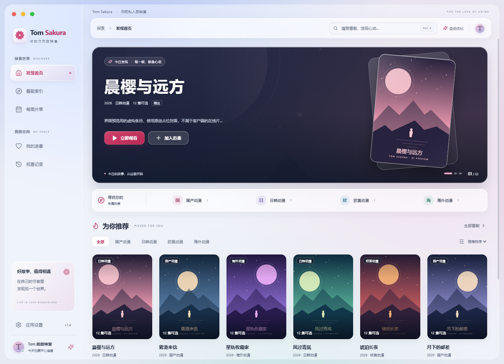
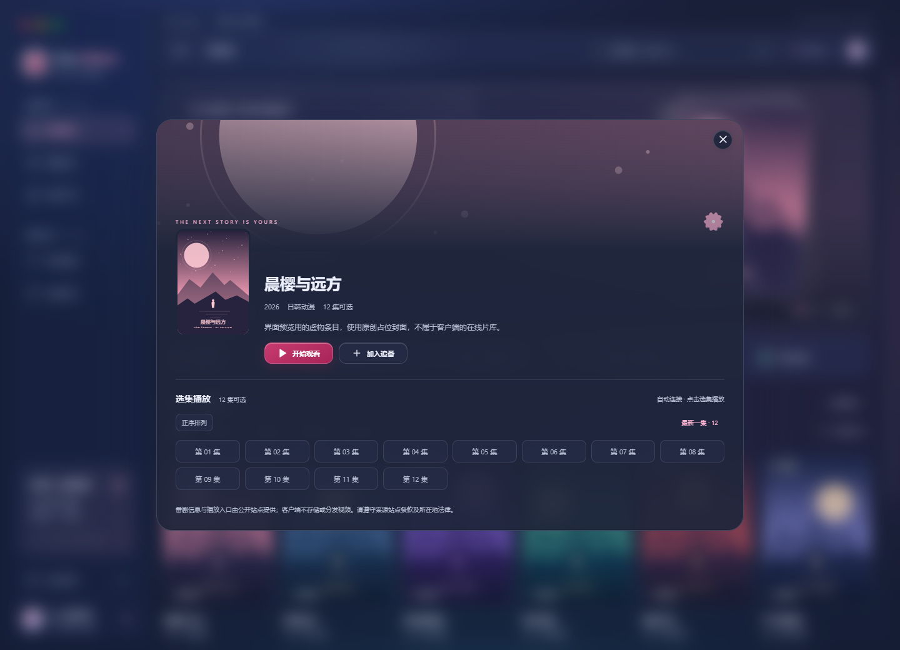
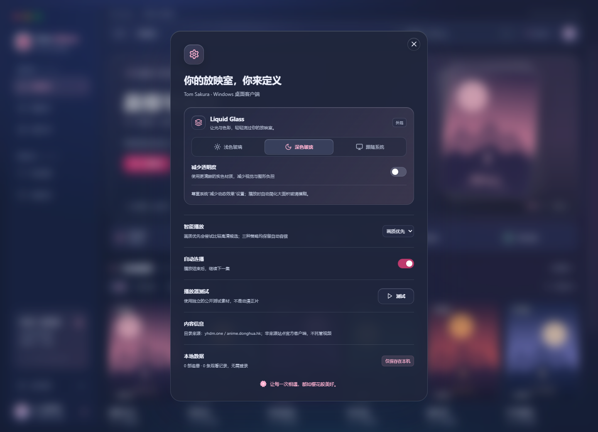

# Tom Sakura

**Windows 10 / 11 x64 番剧桌面客户端** · 液态玻璃界面 · 断点续播 · 画质择优与自动切源。运行发行包不需要安装 Node.js，也不用打开浏览器。



> 截图使用原创封面与虚构条目展示界面；这些条目不属于正式版在线目录。

## 三步开始

1. **下载**：在 GitHub 仓库的 **Releases** 页面打开 **v1.4.0**。想直接试用就选 `Portable.exe`；想安装到电脑就选 `Setup.exe`。
2. **选集**：打开客户端，搜索番名并进入详情，点击集数。客户端自动选择入口，观看页不显示线路或媒体地址。
3. **调整画质**：进入 **应用设置 → 默认播放策略 → 画质优先**。下次打开视频时会比较已有 HLS 候选，仍允许自动降档与切换。偏重稳定性可以保留默认的 **流畅优先**。

### 深色详情与选集



### 画质与外观设置



## 升级与打开

**先完全退出旧版，再打开 1.4。** 单实例机制会把重复启动请求交给仍在运行的旧窗口。界面左下角应显示 `v1.4`。

- 免安装版：`release/1.4.0/Tom Sakura-1.4.0-x64-Portable.exe`
- 安装版：`release/1.4.0/Tom Sakura-1.4.0-x64-Setup.exe`
- 目录版：`release/1.4.0/win-unpacked/Tom Sakura.exe`（需保留整个文件夹）
- 校验文件、中文使用说明位于同一版本目录。旧发行包保留，不会强行关闭旧程序或删除用户数据。

Windows 10 / 11 x64，需要联网。发行包尚未签名，系统可能提示未知发布者。免安装版仍会在当前用户应用数据目录保存设置、收藏和观看记录。

## 1.4 原始画质择优

在「应用设置 → 默认播放策略」选择「画质优先」，下一次加载视频时生效于选源。播放中切换也会调整当前 HLS 码率上限，但不会为此强制重连。

在画质模式下，先验证兼容的低码率档，再对候选的最高分辨率档做限时抽样。两档合计仍最多取样 128 KiB，比较续播位置及后续片段。只有带宽估计能支持（含播放倍速余量）的高清档才加权；高清档抽样失败不判定整条地址失效。最终由 HLS 自动调档，保留降级、切换和续播。播放器显示解码画面尺寸，不把片源的标签或超分辨率输出当成母版画质。

参考了 [Kazumi](https://github.com/Predidit/Kazumi) 的片源与超分分离思路。Kazumi 主程序为 GPL-3.0，独立规则仓库为 MIT。本版本未复制上游代码、加载社区规则、新增站点或接入 Anime4K；继续使用已有来源和授权地址导入。码率与尺寸不能证明编码质量，同站同集也未必有更高清候选。

## 1.3 液态玻璃界面与自检

- 浅色珍珠玻璃默认主题、深色玻璃、跟随系统；选择保存在本机，不修改旧版追番、历史、倍速和播放策略。
- 柔和彩色背景、半透明侧栏、悬浮工具栏、细高光边缘、叠层海报、圆角控件；红黄绿窗口按钮仍执行 Windows 关闭、最小化、最大化 / 还原。
- 工具栏光泽随指针轻微变化，不触发 React 重绘；系统请求减少动态效果时停用。
- 增加“减少透明度”；尊重系统辅助功能偏好。播放时自动关闭大面积背景模糊，视频本身不加滤镜或折射效果。
- 清理未经验证的绿色可播状态、重复的通用分类和“点击查看选集”角标；首页分页只显示实际推荐数量。
- 检查浅色 / 深色、小屏与长标题、弹窗滚动和焦点恢复；可见版本由 package.json 自动注入，避免界面与 EXE 版本不一致。

这是 **Windows 内的 macOS Liquid Glass 风格模拟**，不是 macOS 原生系统材质，也不透出真实桌面。没有开启透明原生窗口或关闭硬件加速。

文档截图位于 `docs/screenshots/`，使用原创封面和虚构条目。可通过 `npm run build` 后运行 `npx electron scripts/capture-docs.cjs` 重新生成，不修改正式目录或用户数据。

## 沿用的 1.2 播放修复

这次不是只增加地址：

- **受控 HLS 引擎优先**：Chromium 的 `canPlayType` 返回 `maybe` 不再直接触发不透明的原生 HLS 路径。优先使用 hls.js / MSE，统一码率、超时、恢复和续播策略；没有 MSE 支持时才考虑原生路径。
- **真实片段预检**：不把清单返回 HTTP 200 当成可播。检查播放位置对应的片段及下一片段；每个候选合计读取最多 128 KiB 的视频样本后取消余下下载。正常 GET 避免不必要的 Range/CORS 兼容问题；字节范围型清单才使用 Range。
- **比较持续承载能力**：结合片段大小、时长、抽样吞吐、播放倍速和响应时间，不只选择第一个快速返回的地址。小样本估计不等于全程带宽保证。
- **覆盖后段备用入口**：最多保留 16 个不同的站点媒体地址，不再固定丢弃第 8 条以后的入口。预检最多 4 个并发，总预算 5.5 秒，并取消落选请求。
- **防止假顺畅**：`canplay`、`playing` 或没有实质推进的 `timeupdate` 不会无限重置超时。默认流畅策略连接等待 10 秒、持续无进展 8 秒；反复短卡顿也有累计预算。
- **分层恢复**：有较低清晰度时先尝试降级；否则保留进度更换候选。播放错误、卡顿和解码异常有边界，解码恢复只尝试一次。用户暂停和主动定位不作为网络卡顿惩罚。
- **流畅优先 / 均衡 / 画质优先**：策略可保存。流畅模式在上游提供多清晰度时限制自动上探码率。**单清晰度视频无法由客户端凭空变成低清晰度；不提供服务端转码。**
- **失效地址只自动重取一轮**：显式刷新不再返回刚失败的缓存地址；已经失败且未变化的地址不无限循环。连接恢复链有总预算，真正连续播放后才清除启动限制。
- **进度保护**：固定本次恢复目标，避免空媒体初始化的零位置覆盖已保存进度；HLS 从目标位置加载，不在初始化阶段反复强行寻址。
- **手动优化与回退**：观看页提供不显示线路的“优化播放”；没有更合适的候选时尝试恢复原播放，避免优化按钮直接破坏唯一可用源。保存位置不适配新视频时可选择“从头重试”，不清空其他番剧历史。
- **兼容性**：标准化旧式十进制 AVC codec 名称；避免用音频专用 rendition 代替视频验证；没有视频画面的持续音频播放不被当成动漫播放成功。
- **复制诊断**：手动复制片名、集数、阶段、缓冲、引擎、错误计数与最近媒体状态。白名单过滤，不复制源地址、Cookie、令牌、任意异常字符串或本机文件路径；不自动上传。

预检仍只验证有限样本，之后的片段、网络和服务端都可能变化。后续由实际播放进展、卡顿累计和超时继续监测。不能承诺整站所有视频、所有时段永远可用。

## 其他功能

在线首页、搜索、国家分类、年份筛选、分页；标题排序针对已加载列表。详情、60 集分组选集、正序 / 倒序、最新集；追番、历史、完成标记、断点续播。0.5–2 倍速与可关闭的自动连播；原生全屏、F11 窗口全屏、Ctrl+K 搜索、Escape 退出全屏或关闭弹窗。

无边框独立窗口、单实例、窗口位置保存、播放时防止屏幕休眠、关闭后台计时器节流以避免播放监视误触发、弹窗焦点限制与关闭后焦点恢复。播放器连通性测试使用独立公开素材，不冒充番剧，不写入观看历史。

## 内容与权限边界

主要目录与媒体入口来自 `yhdm.one` 的公开 HTML / JSON；目录读取失败时可降级到 `anime.donghua.hk`。来源身份保留在 `one:` / `sakura:` ID 中，不模糊匹配不同季、配音版或特别篇。

本程序不是来源站点的官方客户端，无法获知或复制其内部源码。只静态解析目录、选集和显式地址，不执行站点广告脚本、iframe 或播放器脚本。不绕过登录、付费、DRM、防盗链、HTTP 拦截；不伪造来源头，不关闭 TLS、CORS 或浏览器网络安全，不通过特权进程代理任意媒体地址。

客户端不提供番剧离线下载或自行托管、分发。播放可能产生正常浏览器缓存。使用者须遵守来源站点条款、内容权利和所在地法律。隐藏线路是界面抽象，不是地址加密；系统工具仍可观察本机网络请求。

不支持 DASH、DRM 或要求自定义请求头的片源。HLS 的 MSE 播放与预检需要 CDN 正确支持跨域。内容下架、全部地址失效、区域限制、编码不兼容或带宽不足，无法仅靠客户端恢复。

## 开发与打包

需要 Node.js 22.12+（建议 24），首次安装 Electron 需联网。

```sh
npm install
npm run dev
npm run build
npm start
```

```sh
npm run pack
npm run dist
node scripts/checksums.cjs
```

当前输出目录是 `release/1.4.0/`。已有目录版时可分别打包，避免一起压缩超过命令超时：

```sh
npx electron-builder --prepackaged release/1.4.0/win-unpacked --win portable --x64
npx electron-builder --prepackaged release/1.4.0/win-unpacked --win nsis --x64
```

图标位于 `assets/`，`scripts/make-icons.py` 可重建（仅重建图标时需要 Pillow）。

## 维护模式：导入自有 / 授权地址

按 `Ctrl + Shift + M` 打开原生 JSON 文件选择器。此入口不出现在普通观看界面。导入会完整替换本机设置；校验成功后原子保存到 Electron 用户数据目录的 `sources.json`。

```json
{
  "one:20240001": {
    "1": [
      "https://primary.example.com/episode-01.m3u8",
      "https://backup.example.com/episode-01.mp4"
    ]
  }
}
```

上述 ID、域名仅说明格式，不是可用片源。维护配置每集 1–8 个地址，旧版单字符串地址仍兼容；站点候选池另有最多 16 个地址的上限。只接受 HTTP(S)，拒绝脚本 / 本地文件协议与嵌入账号密码，文件最多 2 MB。不要分享含令牌的真实配置。

## 验证

```sh
npm test                  # 离线测试（含外观偏好与基础文字对比度）
npm run test:appearance   # 主题、持久化、窗口操作、辅助功能、小屏、播放材质
npm run test:desktop      # 模拟媒体事件的真实 UI 测试
npm run test:resilience   # 8 类确定性桌面回归
npm run test:media        # 公开测试流真实解码、拖动、续播、倍速
npm run test:provider     # 来源站点的实际番剧样本
npm run test:failover     # 在测试中阻断主媒体域名
npm run test:soak         # 故障接管后持续播放 45 秒
npm run test:app          # 实际 main / preload / renderer 与在线目录
```

额外测试标题可通过 `TOM_SAKURA_TEST_TITLE` 环境变量指定。

```sh
npx electron tests/app-live.cjs --packaged --play --quality
node tests/package-smoke.cjs
```

已覆盖：反复 `canplay` 却没有进展、短卡顿累计、用户暂停、手动优化、强制刷新、零位置初始化、无更优源时回退、从头重试、清单正常但片段失效、续播目标附近的片段检查、AVC 旧式 codec、吞吐与倍速选择、剪贴板脱敏。

两个实际样本《武神主宰》《葬送的芙莉莲》已在主媒体域名被测试阻断的情况下完成拖动、续播和 1.5 倍速检查；持续 45 秒均实际推进约 68 秒，并完成 1080p 视频解码。**这不是整站可用性承诺，也不是整集无卡顿认证。**

打包资源还验证了真实在线搜索、24→48 项分页与播放；实际 EXE 验证了品牌元数据、启动和正常退出。系统安装不自动执行，避免修改用户的卸载注册与现有安装。发行归档另做完整性与 SHA-256 检查。

## 依赖审计备注

本次 `npm audit --omit=dev` 未发现已知生产依赖漏洞。完整审计目前报告构建链中的 picomatch ReDoS 公告（GHSA-fc5q-39xc-vjpf），通过 Vite / electron-builder 等形成 10 个高危依赖节点；`npm audit fix` 暂不能消除。不要将开发服务暴露到公网，也不要向构建工具传入不可信的 glob。不能将完整依赖审计描述为零漏洞。

## 安全约束

上下文隔离、沙箱、关闭 Node 集成；生产窗口关闭开发者工具；禁止导航、弹窗、webview、远程脚本与 iframe。IPC 仅允许应用主窗口主框架；诊断只支持白名单数据写入剪贴板，不提供读取剪贴板接口。

目录只允许固定来源与指定路由，拒绝跨域重定向，12 秒超时、2 MB 页面上限、缓存与并发去重；分页使用短期不透明游标。媒体预检由浏览器沙箱执行并遵循正常 CORS，清单读取上限 1 MiB，视频样本读取后取消；HLS 设置缓冲目标，但不是整个进程的内存硬上限。
